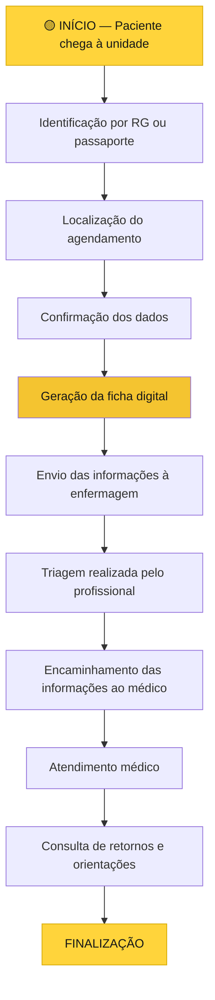

# 

<h3 align="center">TECNOLOGIA DE INTERAÇÃO PARA ATENDIMENTO E ORGANIZAÇÃO</h3>

  <strong>Tecnologia a serviço da dignidade humana.</strong>

  
  
  
  

---

## ◈ NAVEGAÇÃO

  <a href="#sobre-o-projeto">Sobre</a> •
  <a href="#objetivos">Objetivos</a> •
  <a href="#funcionamento">Funcionamento</a> •
  <a href="#acessibilidade">Acessibilidade</a> •
  <a href="#impacto">Impacto</a> •
  <a href="#equipe">Equipe</a>

---

## 🟡 SOBRE O PROJETO

O **T.I.A.O.** é um projeto tecnológico desenvolvido com a proposta de auxiliar na organização dos processos administrativos de atendimento em unidades públicas de saúde, especialmente no Sistema Único de Saúde (SUS).

A iniciativa surgiu da observação de dificuldades enfrentadas diariamente por pacientes e profissionais, como filas extensas, demora na confirmação de consultas e exames, perda de fichas físicas e falhas na comunicação entre setores.

Nossa proposta é utilizar a tecnologia para proporcionar um atendimento mais organizado, acessível e humanizado.

> **Nossa missão:** transformar processos administrativos por meio da tecnologia, colocando as pessoas no centro da inovação.

## 🟡 OBJETIVOS

- Reduzir etapas burocráticas no atendimento.
- Diminuir a utilização de fichas físicas.
- Facilitar a identificação e confirmação dos pacientes.
- Melhorar a comunicação entre recepção, enfermagem e equipe médica.
- Organizar o fluxo de informações.
- Facilitar o acesso a informações sobre consultas, exames e procedimentos.

---

## 🟡 COMO FUNCIONA?

O T.I.A.O. foi idealizado para atuar como um terminal inteligente de atendimento administrativo.

### Fluxo de funcionamento

### Etapas do processo

🟡 01 — Identificação do paciente

O sistema realiza a leitura do documento de identificação, seja RG ou passaporte, permitindo localizar os dados do paciente.

🟡 02 — Localização do agendamento

O T.I.A.O. consulta os registros disponíveis para localizar consultas, exames ou procedimentos previamente agendados.

🟡 03 — Confirmação das informações

São verificadas informações como data, horário, local e demais dados necessários ao atendimento.

🟡 04 — Geração da ficha digital

O sistema gera a ficha digital e encaminha as informações à equipe responsável, reduzindo a necessidade de documentos físicos.

🟡 05 — Organização do atendimento

A enfermagem realiza a triagem e encaminha as informações ao médico, que conduz o atendimento.

🟡 06 — Orientações finais

Ao final do processo, o paciente poderá consultar informações sobre retornos, remarcações, datas, horários e preparações necessárias para procedimentos futuros.

> **IMPORTANTE:** O T.I.A.O. não realiza triagem clínica, diagnósticos ou avaliações médicas. Sua atuação está concentrada nos processos administrativos e na organização das informações.

Os atendimentos de emergência e os pacientes encaminhados pelo SAMU ou pelos Bombeiros continuam sendo direcionados à recepção humana.

---

## 🟡 ACESSIBILIDADE E INCLUSÃO

A tecnologia deve ser acessível a todos.

Por isso, o projeto contempla possibilidades de expansão que buscam atender diferentes necessidades:

| Recurso | Finalidade |
|---|---|
| 🌎 Suporte multilíngue | Orientações em diferentes idiomas |
| 🔊 Assistência por áudio | Auxílio a pessoas com deficiência visual |
| 🪪 Leitura de passaporte | Identificação de pacientes estrangeiros |

Entre os idiomas considerados estão espanhol, inglês, francês e crioulo haitiano.

---

## 🟡 IMPACTO ESPERADO

O projeto prevê a realização de um estudo de caso para comparar o atendimento antes e depois da utilização do sistema.

Os critérios de avaliação incluem:

- Tempo total de atendimento.
- Tempo de identificação do paciente.
- Tempo de geração da ficha digital.
- Tempo de encaminhamento das informações.
- Organização do fluxo administrativo.
- Possíveis falhas durante o atendimento.

O objetivo é verificar se a solução contribui para melhorar a organização e reduzir o tempo gasto nas etapas administrativas.

---

## 🟡 NOSSA INSPIRAÇÃO

Mais do que desenvolver uma solução tecnológica, o T.I.A.O. nasceu de uma reflexão sobre dignidade, cuidado e respeito ao próximo.

Nossa identidade conceitual está relacionada à filosofia africana **Ubuntu**, frequentemente traduzida pela expressão:

> "Eu sou porque nós somos."

Também encontramos inspiração na mensagem de conexão humana presente na música *Principia*, de Emicida.

O amarelo foi escolhido para representar acolhimento, esperança e cuidado.

Acreditamos que a tecnologia deve estar a serviço das pessoas.

---

## 🟡 EQUIPE DE DESENVOLVIMENTO

Projeto desenvolvido em equipe no contexto acadêmico da disciplina de Engenharia de Prompt e Aplicações em IA.

👥 CONHEÇA OS INTEGRANTES

- Adrian Cristian dos Santos
- Alexsander Rosa Ribeiro
- Carlos Gomes de Souza Junior
- Cauã Francisco Gomes da Silva
- Emylly Nickolly Viana de Oliveira
- Guilherme Pinheiro Paulino
- Kauan Camargo Anastácio
- Mateus Izac Batista
- Murilo Silva de Jesus
- Samuel Freitas Brito
- Valdeir Almeida Silva
- Vitória Cristina Martins Costa

**Instituição:** Universidade Cidade de São Paulo (UNICID)

**Professora:** Andrea Marins Cristóvão

**Ano:** 2026

---

  

<h3 align="center">QUANDO O ATENDIMENTO MELHORA PARA UM, MELHORA PARA TODOS.</h3>

  <i>Tecnologia, humanidade e dignidade caminhando juntas.</i>

